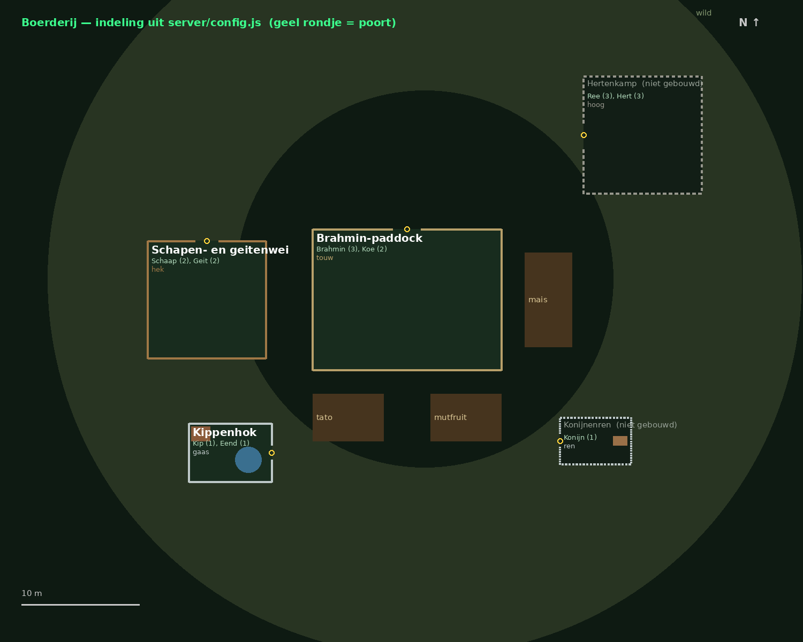

# Vault 25 — Brahmin Paddock 🐄☢️

Multiplayer-AR voor de Vault 25 LARP. Spelers zien met de **Android-app** een
paddock met vee, akkers en wild over het terrein heen. Ze **jagen**, **oogsten**,
**melken** en **leiden uitgebroken vee terug** — en zien elkaars acties.

- Eén **gedeelde wereld** op de GM-laptop: wie als eerste oogst of raakt, wint.
- **Rollen met codes**: alleen *jagers* krijgen buit van wild, alleen *boeren*
  kunnen oogsten en melken. Vee terugbrengen kan iedereen.
- Werkt op een **eigen wifi zonder internet**.
- **GM-scherm** voor spelers, rollen, tassen, inleveringen, de staat van het
  hek, uitbraken en de wildstand.
- **Radioberichten** voor FreeRadical op de bunkerradio als vee te lang los
  loopt of niemand meer naar de paddock gaat.

```
 Telefoons (app) ──wifi──► ComputerVanTom: server/ (poort 8090)
                               ├─► http://<pc>:8090/gm.html     (SL)
                               └─► http://<pc>:8090/radio/next  (bunkerradio-Pi)
```

## Snel starten

### 1. Server op ComputerVanTom
Node.js 18 of nieuwer nodig. Poort **8090** (8080 is al van `gm_control.html`).

Eenmalig als service installeren, zodat hij bij het opstarten vanzelf draait:
```bash
cd server
./install-service.sh
```
Of los starten om te proberen: `cd server && npm install && npm start`.

```bash
sudo systemctl restart vault25-paddock   # na een wijziging in config.js
journalctl -u vault25-paddock -f         # meekijken: adressen, spelers
```
**Verander eerst** in `server/config.js`: `gmPassword` en de `roles`-codes.

Thuis testen zonder telefoon: open `http://localhost:8090` → SIMULATIE.

Het IP-adres van de pc wisselt via DHCP. Geef de pc liefst een vast adres in
de router; anders gebruiken spelers **ZOEK SERVER** op het startscherm.

### 2. De app op Android-telefoons
De APK wordt **automatisch gebouwd door GitHub** bij elke push:
GitHub → **Actions** → laatste run "Android APK" → onderaan **Artifacts** →
`vault25-paddock-apk` (zip met de APK).

Tag je een versie (`git tag v2.0.1 && git push --tags`), dan staat de APK ook
onder **Releases** — handig om op een telefoon direct te downloaden.

Installeren: APK op de telefoon openen → "installeren uit onbekende bron"
toestaan. Updates installeren over de oude heen (vaste sleutel), dus spelers
houden hun tas en rollen.

Zelf bouwen kan ook: Android Studio + `npm install && npx cap sync android &&
npx cap open android`.

### 3. Op het event
- Wifi-router of hotspot waar laptop én telefoons op zitten (internet niet nodig).
- Laptop: `npm start`; het serveradres staat in beeld.
- Spelers: app openen → naam → eventueel rolcode → serveradres (eenmalig) → START.
- SL: GM-scherm op een tweede apparaat of op de laptop zelf.

## Spelregels in het kort

| Actie | Wie | Wat gebeurt er |
|---|---|---|
| Schieten op wild | iedereen | raak = beest dood; alleen een **jager** krijgt vlees/huid |
| Oogsten | alleen **boer** | eerste boer krijgt de oogst; akker begint opnieuw |
| Vee verzorgen | **veeboer** van minstens het niveau van het dier | eieren, veren, haar, mest of botten; eerste wint |
| Vee terugleiden | iedereen | door de **poortopening**; 5 kroonkurken voor wie leidde |
| Inleveren | iedereen | tas → code → SL keurt goed op het GM-scherm |

Andere spelers zien je als figuurtje (rood = jager, geel = boer, groen = geen
rol), horen je schoten en lezen in de nieuwsregel wat je doet.

## Vee en hokken

Alle negen veesoorten uit barter 2.0 / het resourceoverzicht, met hun niveau.
Wat ze opleveren komt uit de component lore Dierlijk, zodat de handelspost met
de gewone resourcekaartjes kan uitbetalen.

| Hok | Hektype | Dieren (niveau) | Levert | Standaard |
|---|---|---|---|---|
| Brahmin-paddock | touw | brahmin (3), koe (2) | mest, haar | gebouwd |
| Schapen- en geitenwei | houten hek | schaap (2), geit (2) | haar, mest | gebouwd |
| Kippenhok | kippengaas + hok + vijver | kip (1), eend (1) | ei(eren), veren | gebouwd |
| Konijnenren | laag gaas + konijnenhok | konijn (1) | mest, haar | niet gebouwd |
| Hertenkamp | hoog wildraster | ree (3), hert (3) | mest, botten | niet gebouwd |

Verzorgen volgt de skill *Boer vee niveau 1–3*: rolcodes `HOK-1`, `HOK-2`,
`HOK-3` (veranderen in `server/config.js`). Veeboer 2 mag ook niveau-1-vee.
Op het GM-scherm zet je een hok op **GEBOUWD** zodra spelers het in-game
neerzetten, en zet je er dieren in of uit (na aankoop, verkoop of slacht).
Elk hok heeft een eigen poort; een dier kan alleen terug in z'n eigen hok.
Soorten, producten, hokken en maten: `species` en `pens` in `server/config.js`.



## Uitbraken en de staat van het hek

Dieren breken niet op een vaste klok uit. Op het GM-scherm zet je **elk hok
apart** op **goed**, **beschadigd** of **kapot** (bv. als het kippenhok dat
spelers bouwden is aangevallen):

| Staat | Vanzelf uitbreken | Hek |
|---|---|---|
| goed | nooit | alleen door de poortopening |
| beschadigd | gemiddeld 1× per 12 min | alleen door de poortopening |
| kapot | gemiddeld 1× per 3 min | houdt niets tegen: overal in en uit |

Spelers zien de schade (stukken hek weg) en krijgen een melding met de naam
van het hok. Met **UITBRAAK NU** per hok start je zelf een uitbraak. Nooit meer
dan 3 dieren tegelijk buiten (alle hokken samen); een teruggebracht dier blijft
even rustig. Instelbaar in `paddock` in `server/config.js`.

## Wildstand

Rond de paddock liggen vier gebieden (noord, oost, zuid, west), elk met een
eigen wildstand. Elk geschoten beest — door jagers én niet-jagers — maakt dat
gebied armer; waar veel gejaagd wordt, komt minder en trager wild terug. Een
leeg gebied herstelt in ~2 uur. Op het GM-scherm schaal je de totale
hoeveelheid op of af (uit, ×½ … ×3) en kun je alles herstellen. Instelbaar in
`wildlife` (`depletionPerKill`, `killWeight`, `regenPerHour`).

## Radio (FreeRadical)

De server zet berichten klaar voor de bunkerradio:

| Wanneer | Bericht |
|---|---|
| een dier loopt 5 min los en niemand lokt het | "er loopt een brahmin los aan de noordkant…" |
| 45 min niemand bij de paddock | "de paddock ligt er verlaten bij, de tato staat rijp…" |
| GM zet het hek op beschadigd/kapot/goed | melding over het hek |
| het wild in een gebied is op | "de oostkant is leeggejaagd" |
| GM typt een eigen bericht | dat bericht |

Hetzelfde probleem wordt hooguit 1× per 15 min gemeld; tussen 02:00 en 10:00
niets. Teksten aanpassen: `server/radio-texts.js`.

**Koppelen aan de bunkerradio-Pi:** kopieer `radio/paddock_radio.py` naast
`freeradical_radio.py` en roep tussen twee nummers aan:
```python
from paddock_radio import fetch_paddock_bulletin
b = fetch_paddock_bulletin()      # None als er niets is of de server onbereikbaar is
if b:
    tekst = b["text"]             # kant-en-klaar, of laat Ollama b["prompt"] uitspreken als FreeRadical
```
Testen: `PADDOCK_SERVER=192.168.68.116:8090 python3 paddock_radio.py`

## Modi

| Modus | Nodig | Gebruik |
|---|---|---|
| START (terrein) | GPS | het event: vast GPS-anker uit `server/config.js` |
| HIER | GPS | paddock op ware grootte waar je staat |
| KAMER-AR | camera | verkleind voor je neus, binnen testen |
| SIMULATIE | niets | pc of telefoon, slepen + WASD |

Let op: in HIER en KAMER zet elke telefoon de paddock vóór zichzelf neer.
Figuurtjes van anderen kloppen dan niet met waar ze écht staan. Alleen in
TERREIN delen alle telefoons hetzelfde GPS-anker.

## Bestanden

```
server/config.js     >>> SPELREGELS, ROLCODES, GM-WACHTWOORD, ANKER, RADIO <<<
server/radio-texts.js radioteksten voor FreeRadical
server/sim.js        de gedeelde wereld + alle regels
server/server.js     netwerk, opslag (server/data/save.json), GM-toegang, /radio/next
server/install-service.sh  installeert de server als systemd-service
server/test/         spelregels, netwerk, telefooncode, GM-scherm (npm test)
radio/paddock_radio.py  koppeling voor de bunkerradio-Pi
www/                 de app (ook geserveerd door de server)
www/js/config.js     standaard serveradres in de app
www/gm.html          GM-scherm
www/vendor/          A-Frame 1.6.0 + AR.js 3.4.7 (lokaal: werkt zonder internet)
android/             Android-project (Capacitor)
.github/workflows/   automatische APK-build
```

## Tests
```bash
cd server && npm test
```
Draait de spelregels (meerdere spelers, uitbraken, wildstand, radio), een echte
server met WebSocket-clients, de echte telefooncode en het echte GM-scherm
tegen die server.

## Tips
- Alles in `server/config.js` aanpassen → server herstarten. De app hoeft
  niet opnieuw gebouwd te worden.
- Tassen, rollen en inleveringen staan in `server/data/save.json`. Maak daar
  tussen de speldagen een kopie van.
- Telefoon kwijt of app verwijderd? Dan is de speler een nieuwe speler. Geef
  de rol opnieuw via het GM-scherm.
- Firefox werkt niet voor GPS-AR; de app gebruikt de Android-WebView (Chrome).
